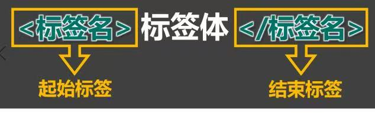
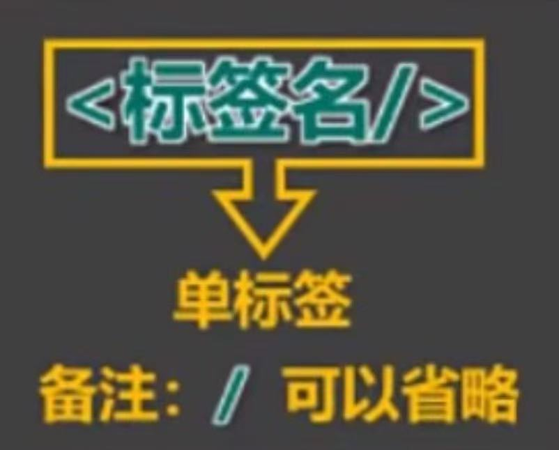
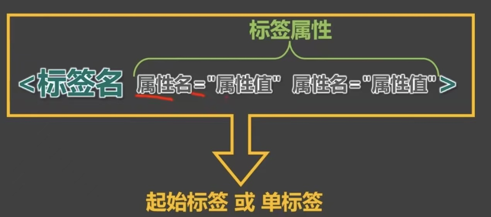
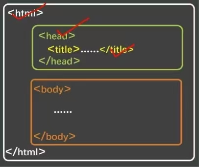
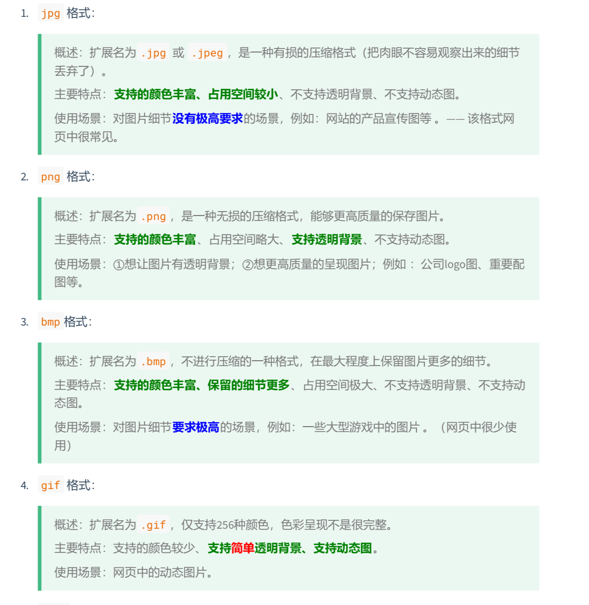
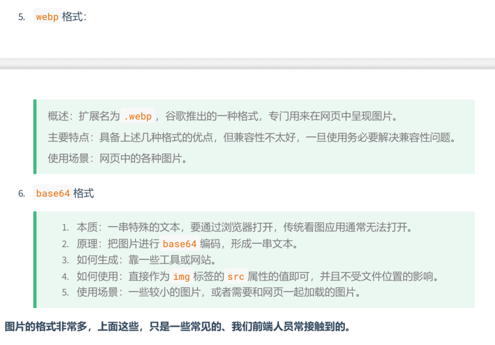

# HTML入门

### 1. 认识HTML

***

1. 全称<mark>H</mark>yper<mark>T</mark>ext <mark>M</mark>arkup ==L==anguage
   译为：超文本标记语言
   <mark>**超文本**</mark>：暂且理解为“超级的文本”，和普通的文本相比，内容更加丰富。
   <mark>**标记**</mark>：文本要变成超文本，就需要用到各种标记符号。
   <mark>**语言**</mark>：每一个标记的写法、读音使用规则，构成标记语言。

### 2.HTML初体验

***

1. 第一步：鼠标右键=>新建=>文本文档=>输入以下内容. 
 ```html
  <marquee>尚硅谷，让天下没有难学的技术</marquee>
 ```
 2. 第二步:修改后缀为.html,然后双击打开即可。
 3. 程序员写的叫源代码，要交给浏览器进行渲染。
 4. 借助浏览器看网页源代码，具体操作：
   在网页空白处：鼠标右键==>查看网页源代码。

### 3. HTML标签

***

1. **标签**又称**元素**，是HTML的基本组成单位。
2. 标签分为：**双标签**与**单标签**（绝大多数都是双标签）。
3. 标签名不区分大小写，但推荐小写，因为小写更规范。
4. 双标签：
   

5. 单标签：
   
   示例代码：
   ```html
   <input>
   ```

6. 标签之间的关系：并列关系、嵌套关系，可使用tab键进行缩进：
  ```html
   <marquee>
      尚硅谷，让天下没有难学的技术
      <input>
   </marquee>
   ```

## 4. HTML标签属性
***
1. 用于给标签提供附加信息。
2. 可以写在：**起始标签**或**单标签**中，形式如下：
   
   例如:
   ```html
   <marquee loop="1" bgcolor="orange">尚硅谷，让天下没有难学的技术！</marquee>
   <input type="password">

3. 有些特殊的属性，没有属性名，只有属性值，例如：
   ```html
   <input disable>
   
4. 注意点：
   1. 不同的标签有不同的属性；也有一些通用属性。
   2. 属性名、属性值不能乱写，都是W3C规定好的。
   3. 属性名、属性值，都不区分大小写，但推荐小写。
   4. 双引号，也可以写成单引号，甚至不写都可以，但还是推荐写双引号。
   5. 标签中不要出现同名属性，否则后写的会失败，例如：
      ```html
      <input type="text" type="password">
      ```
 ## 5.HTML基本结构
 ***

 1. 在网页中，如何查看某段结构的具体代码？--点击鼠标右键，选择“检查”。
 2. 【检查】和【查看网页源代码】的区别：
   >【查看网页源代码】看到的是：程序员编写的源代码。
   >【检查】看到的是：经过浏览器“处理”后的代码。
   >备注：日常开发中，【检查】用的最多。

 3. 网页的基本结构如下：
   >1. 想要呈现在网页中的内容写在body标签中。
   >2. head标签中的内容不会出现在网页中。
   >3. head标签中的内容写在body标签中。
   >4. 图示：
   >   ![基本结构]（）
   >5. 代码:
   >```
   ><html>
   >   <head>
   >   <body>
   >   ...
   >   </body>
   >   </head>
   ></html>
   >```

## 6. HTML注释
***
1. 特点：注释的内容会被浏览器所忽略，不会呈现到页面中，但源代码依旧可见。
2. 作用：对代码进行解释和说明。
3. 写法：
 ```html
   <!-- 下面文字只能滚动一次 -->
   <marquee loop="1">尚硅谷</marquee>

   <!-- 下面的文字可以无限滚动 -->
   <marquee>尚硅谷123</marquee>
```
4. 注释不可以嵌套。
## 7. HTML文档声明
***
1. 作用：告诉浏览器当前网页版本。
2. <mark>新写法<mark>:
   ```html
   <!DOCTYPE html>或<!DOCTYPE HTML>
   ```
3. 注意：文档声明，必须在网页的第一行，且在html标签外侧。
## 8. HTML字符编码
***
1. 计算机对数据的操作：
   >-存储时，对数据进行：**编码**
   >-读取时，对数据进行：**解码**
2. 编码、解码，会遵循一定的规范--**字符集**
3. 字符集有很多，常见的有：
   1. ASCII：大写字母、小写字母、数字、一些符号。
   2. ISO 8859-1：在ASCII码的基础上，扩充了一些希腊字符等。
   3. GB2312:继续扩充。
   4. GBK：支持繁体中文。
   5. <span style="color:red">UTF-8</span>：包含世界上所有语言的：所有文字与符号。--很常用。
4. 使用原则是怎样的呢？
   > 原则一：存储时，无比采用合适的字符编码。
   > 原则二：存储时采用哪种编码方式，读取时就采用哪种方式解码。
5. 总结：
   -平时编写代码时，统一采用UTF-8编码。
   -为了让浏览器在渲染html文件时，不犯错误，可以通过meta标签配合charset属性指定字符编码。
   ```
   <head>
      <meta charset="UTF-8"/>
   </head>
   ```
## 9. HTML标准结构
***
-html标准结构如下：
```html
<!DOCTYPE html>
<html lang="zh-CN">
   <head>
      <meta charset="UTF-8">
      <title>我是一个标题</title>
   </head>
   <body>
   
   </body>
</html>
```
-<mark>输入！</mark>，随后回车即可快速生成标准结构。
-在存放代码的文件夹中存放一个favicon.ico图片，可配置网站图标。
# HTML基础
## 1. 排版标签
***
|标签名|标签含义|单/双标签|
|:----:|:----:|:----:|
|h1~h6|标题|双|
|p|段落|双|
|div|没有任何含义，用于整体布局（生活中的包装袋）。|双|
1. h1最好写一个，h2~h6可以适当多写。
2. h1~h6不能互相嵌套。
3. p标签很特殊！它里面不能有:h1~h6、p、div标签。
## <span style="color:red">2. 语义化标签</span>
***
- 概念：用特定的标签，去表达特定的含义。
- 原则：标签的默认效果不重要（后期可以通过CSS随便控制效果），语意最重要！
- 举例：对于h1标签，效果是文字很大（不重要），语义是网页的主要内容。
- 优势：
   - 代码结构清晰可读性强
   - 有利于SEO（搜索引擎优化）
   - 方便设备解析（如屏幕阅读器、盲人阅读器等）。
## 3. 块内元素与行内元素
***
1. **块级元素**：独占一行（排版标签都是块级元素）
2. **行内元素**：不独占一行
3. **使用规则**：
   > 1. **块级元素** 中能写行内元素和块级元素（简单记：块级元素中什么都能写）
   > 2. **行内元素** 中能写行内元素，但不能写块级元素。
   > 3. 一些特殊的规则：
   >  - h1~h6不能互相嵌套
   >  - p中不要写块级元素
## 4. 文本标签_常用的
***
1. 用于包裹、词汇、短语等。
2. 通常写在排版标签里面。
3. 排版标签更宏观（大段的文字），文本标签更微观（词汇、短语）。
4. 文本标签通常都是行内元素。
   |标签名|标签语义|单/双标签|
   |:----:|:----:|:----:|
   |em|要着重阅读的内容|双|
   |strong|十分重要的内容（语气比em要强）|双|
   |span|没有语义，用于包裹短语的通用容器|双|
   > 生活中的例子：div是大包装袋，span是小包装袋。
## 5. 图片标签
***
1. **基本使用**
   |标签名|标签语义|常用属性|单/双标签|
   |:----:|:----:|:----|:----:|
   |img|图片|src:图片路径（又称图片地址）<br>alt:图片描述。<br>width:图片宽度，单位是像素例如：200px或200。<br>height:图片高度，单位是像素，例如：200px或200|单|
   |标签名|标签语义|常用属性|单/双标签|
   总结：
   > 1. 像素(px)是一种单位，学到CSS时，我们会详细讲解。
   > 2. 尽量不同时修改图片的宽和高，可能会出现比例失衡。
   > 3. 暂且认为img是行内元素（学到CSS时，会认识一个新的元素分类，目前只知道：块、行内）
   > 4. alt属性的作用：
      > - 搜索引擎通过alt属性，得知图片的内容。--最主要的作用
      > - 当图片无法展示时，有些浏览器会呈现alt的属性值。
      > - 盲人阅读器会朗读alt属性的值。
2. **路径分类**
   1. **相对路径**：以<span style="color:red">当前位置</span>作为参考点，去建立路径。
         - ./ 同级
         - / 下一级
         - ../ 上一级
   > 注意点：
   > - 相对路径中的./可以省略不写。
   > - 相对路径依赖的是当前位置，后期若调整了文件位置，那么文件中的路径也要改。
   2. **绝对路径**：以根位置作为参考点，去建立路径。
      1. 本地绝对路径：E:a/b/c/奥特曼.jpg.（很少使用）
      2. 网络绝对路径：https://www.atguigu.com/imges/index_new/logo.png
      >注意点：
      >- 使用本地绝对路径，一旦更换设备，路径处理起来比较麻烦，所以>很少使用。
      >- 是使用网络绝对路径，确实方便，但要注意：若服务器开启了防盗>链，会造成图片引入失效。
   3. **常见图片格式**：
   
   
