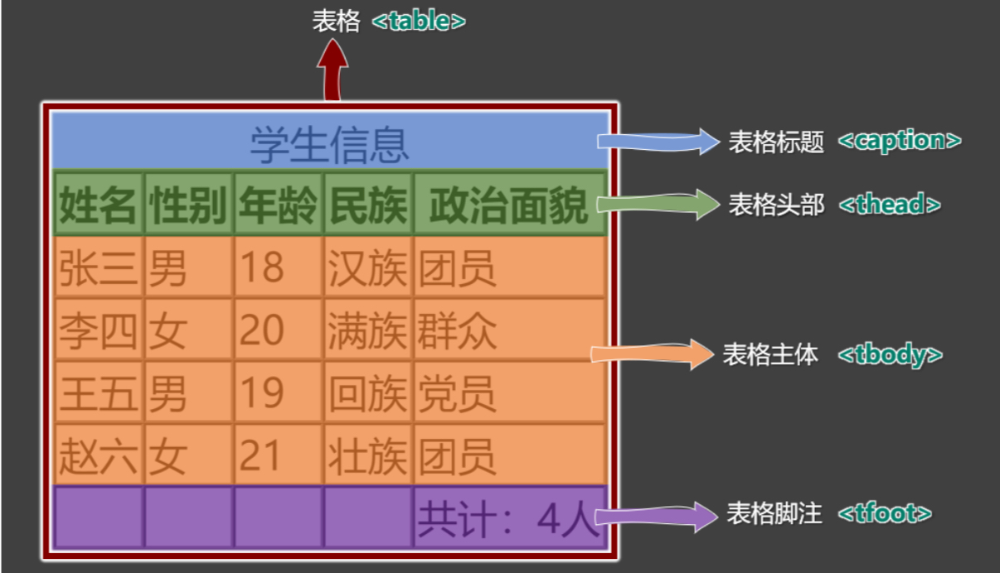
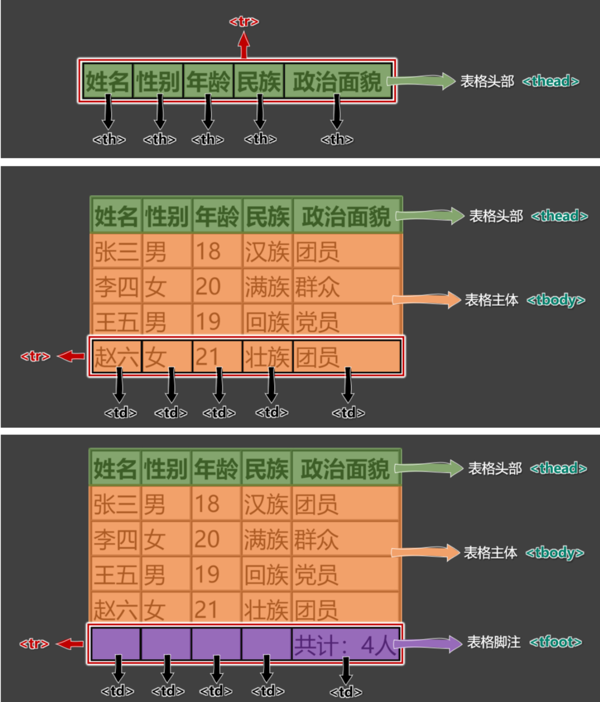
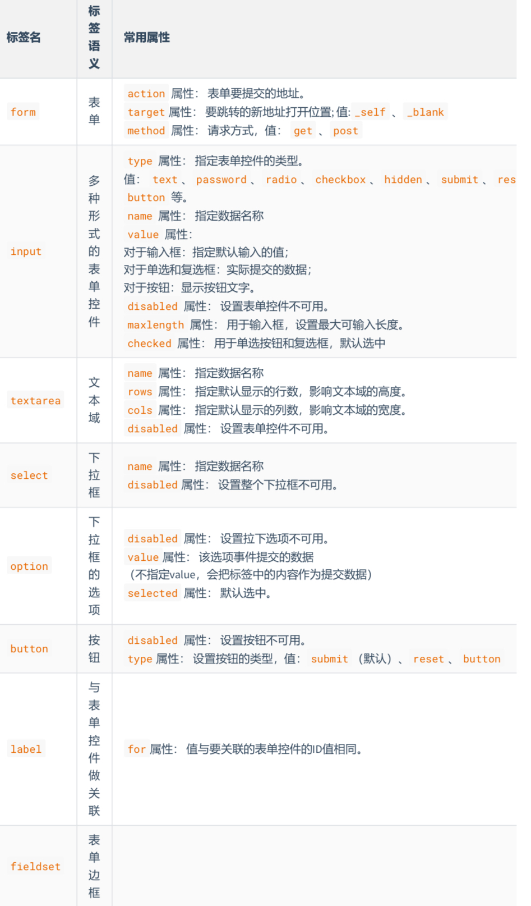

## 6. 超链接
***
主要作用：从当前页面进行跳转。
可以实现：1.跳转到指定页面。2.跳转到指定文件（也可触发下载）3.跳转到锚点位置。4.唤起指定应用。
|标签名|标签含义|常用属性|单/双标签|
|:----:|:----:|:----|:----:|
|a|超链接|1. href:指定要跳转的具体目标<br>2. target:控制跳转时如何打开页面，常用值如下：<br> （1）_self：在本窗口打开。<br>（2） _blank:在新窗口打开。<br>3. id:元素唯一标识，可用于设置锚点。<br>4. name：元素的名字，写在a标签中，也能设置锚点。|双|
1. **跳转页面**
   ```html
   <!-- 跳转到其他网页 -->
   <a href="https://www.jd.com/" target="_blank">去京东</a>

   <!-- 跳转本地网页 -->
   <a href="./10_HTML排版标签.html" target="_self">去看排版标签</a>
   ```
   > 注意点：
   >    1. 代码中的多个空格、多个回车，都会被浏览器解析成一个空格！
   >    2. 虽然a是行内元素，但a元素可以包裹除它自身外的任何元素！
2. **跳转文件**
   ```
   <!-- 浏览器能直接打开文件 -->
   <a href="./resource/自拍.jpg">看自拍</a>
   <a href="./resource/小电影.mp4">看小电影</a>
   <a href="./resource/小姐姐.gif">看小姐姐</a>
   <a href="./resource/如何一夜暴富.pdf">点我一夜暴富</a>

   <!-- 浏览器不能打开的文件，会自动触发下载 -->
   <a href="./resource/内部资源.zip">内部资源
   
   <!-- 触发强制下载 -->
   <a href="./resource/小电影.mp4" download="电影片段">下载电影</a>
   ```
   > 注意点：
      > 1. 若浏览器无法打开文件，则会引导用户下载。
      > 2. 若想强制触发下载，请使用download属性，属性值即为下载文件的名称。
3. **跳转到锚点**
   什么是锚点？——网页中的一个标记点。
   具体使用方式：
      - **第一步：设置锚点**
        ```
         <!-- 第一种方式：a标签配合name属性 -->
         <a name="test1"></a>

         <!-- 第二种方式：其他标签配合id属性 -->
         <h2 id="test2">我是一个位置</h2>
         ```
      - **第二步：跳转锚点**
       ```
         <!-- 跳转到test1锚点-->
         <a href= "#test1">去test1锚点</a >

         <!-- 跳到本页面顶部 -->
         <a href="#">回到顶部</a >

         <!-- 跳转到其他页面锚点 -->
         <a href="demo.html#test1">去demo.html页面的test1锚点</a >

         <!-- 刷新本页面 -->
         <a href="">刷新本页面</a >

         <!-- 执行一段js,如果还不知道执行什么，可以留空，javascript:; -->
         <a href="javascript:alert(1);">点我弹窗</a>
         ```
4. **唤起指定应用**
   通过a标签，可以唤起设备应用程序。
   ```
      <!-- 唤起设备拨号 -->
      <a href= "tel:10010">电话联系</a >
      <!-- 唤起设备发送邮件 -->
      <a href=
      "mailto:10010@qq.com">邮件联系</a >
      <!-- 唤起设备发送短信 -->
      <a href=
      "sms:10086">短信联系</a >
   ```
## 7. 列表
***
1. **有序列表**
   概念：有顺序或侧重顺序的列表。
   标签`<ol></ol>`
2. **无序列表**
   概念：无顺序或不侧重顺序的列表
   标签：`<ul></ul>`
3. **列表嵌套**
   概念：列表中的某项内容，又包含一个列表（注意：嵌套时，一定要把结构写完整li标签最好写在ul或ol中，不要单独使用）
4. **自定义列表**
   1. 概念：所谓自定义列表，就是一个包含术语名称以及术语描述的列表。
   2. 一个dl就是一个自定义列表，一个dt就是一个术语名称，一个dd就是属于描述。
## 8. 表格
***
1. **基本结构**
   1. 一个完整的表格由：表格标题、表格头部、表格主体、表格脚注，四部分组成。
   
   2. 表格涉及到的标签：
   table:表格
   caption:表格标题
   thead:表格头部
   tbody:表格主体
   tfoot:表格注脚
   tr:每一行
   th、td:每一个单元格（备注：表格头部用th、表格主体、表格脚注用：td）
   
2. **常用属性**
   |标签名|标签语义|常用属性|单/双标签|
   |:----|:----|:----|:----|
   |table|表格|width:设置表格宽度<br>height:设置表格最小高度，表格最终高度可能比设置的值大。<br>border:设置表格边框宽度。<br>border:设置边框宽度。<br>cellspacing:设置单元格之间的间距。|双|
   |thead|表格头部|`height` ：设置表格头部高度。<br>`align` ： 设置单元格的水平对齐方式，可选值如下：<br>1. left ：左对齐<br>2. center ：中间对齐<br>3. right ：右对齐<br>`valign` ：设置单元格的垂直对齐方式，可选值如下：<br>1. top ：顶部对齐<br>2. middle ：中间对齐<br>3. bottom ：底部对齐|双|
   |tbody|表格主体|常用属性与thead相同|双|
   |tr|行|常用属性与thead相同|双|
   |tfoot|表格脚注|常用属性与thead相同|双|
   |td|普通单元格|width ：设置单元格的宽度，同列所有单元格全都受影响。<br>heigth ：设置单元格的高度，同行所有单元格全都受影响。<br>align ：设置单元格的水平对齐式。<br>valign ：设置单元格的垂直对齐方式。<br>rowspan ：指定要跨的行数。<br>colspan ：指定要跨的列数。<br>|双|
   |th|表头单元格|常用属性与td相同|双|
3. **跨行跨列**
   1. rowspan：指定要跨的行数
   2. colspan:指定要跨的列数

## 9. 常用标签补充
***
|标签名|标签含义|单/双标签|
|:-----|:----|:----|
|br|换行|单|
|hr|分隔|单|
|pre|按原文显示（一般用于在页面中嵌入大段代码）|双|
## 10. 表单
***

概念：一个包含交互的区域，用于收集用户提供的数据。
1. **基本结构**
   简单梳理
   |标签名|标签语义|常用属性|单/双标签|
   |:----|:----|:----|:----|
   |form|表单|action:用于指定表单的提交地址（需要与后端人员沟通好后确定）<br>target:用于控制表单提交后，如何在页面打开，常用值如下：<br> _self:在本窗口打开<br> _blank:在新窗口打开<br>method:用于控制表单的提交方式，暂时只需要了解|双|
   |input|输入框|type:设置输入框的类型，目前用到的值是text,表示普通文本<br>name:用于指定提交数据的名字（与后端人员沟通后定）|单|
   |button|按钮|暂无|双|
2. **常用表单控件**
   1. 文本输入框
   `<input type="text">`
   2. 密码输入框
   `<input type="password">`
   3. 单选框
   `<input type="radio" name="sex" value="female">女`
   `<input type="radio" name="sex" value="male">男`
   4. 复选框
   `<input type="checkbox" name="hobby" value="smoke">抽烟`
   `<input type="checkbox" name="hobby" value="drink">喝酒`
   `<input type="checkbox" name="hobby" value="perm">烫头`
   5. 隐藏域
   `<input type="hidden" name="tag" value="100">`
   6. 提交按钮
   `<input type="submit" value="点我提交">`
   `<button>点我提交表单</button>`
   7. 重置按钮
   `<input type="reset" value="点我重置">`
   `<button type="reset">点我重置</button>`
   8. 普通按钮
   `<input type="button" value="普通按钮">`
   `<button type="button">点我重置</button>`
   9.  文本域
   `<textarea name="msg" rows="22" cols="3">我是文本域</texterea>`
   10. 下拉框
   ```
   <select name="from">
      <option value="黑">黑龙江</option>
      <option value="辽">辽宁</option>
      <option value="吉">吉林</option>
      <option value="粤" selected>广东</option>
   </select>
   ```
   > 常用属性及注意事项：
   > 1. name 属性：指定数据的名称。
   > 2. option 标签设置 value 属性， 如果没有 value 属性，提交的数据是 option 中间的文字；如果设置了 value 属性，提交的数据就是 value 的值（建议设置 value 属性）
   > 3. option 标签设置了 selected 属性，表示默认选中。
3. **禁用表单控件**
   给表单空间标签设置disabled即可禁用表单控件。
4. **label标签**
   - lablel标签可与表单空间相关联，关联之后点击文字，与之对应的表单控件就会获取焦点。
   - 两种与label关联的方式如下：
      1. 让label标签的for属性的值等于表单控件的id
      2. 把表单控件套在label标签里面。
5. **fieldset与legend的使用
   fieldset可以为表单控件分组，legend标签是分组的标签
6. **表单总结**
   


